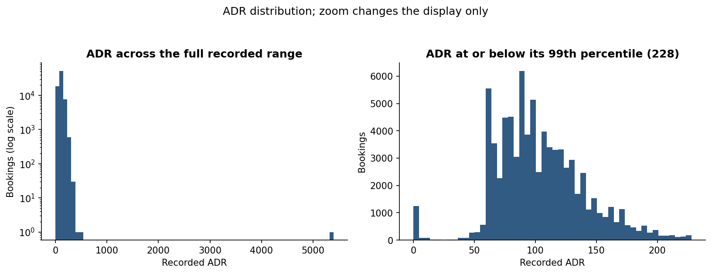
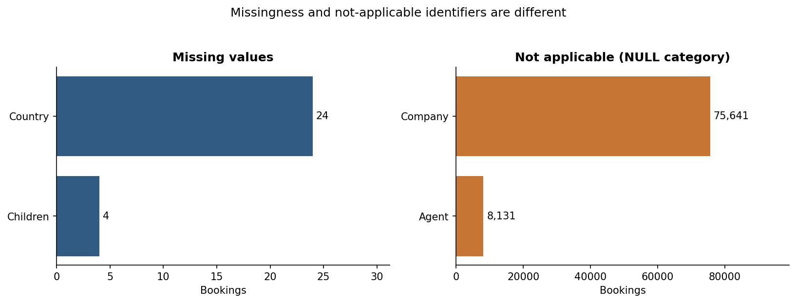
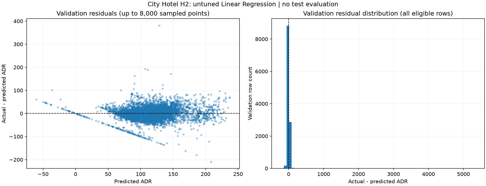
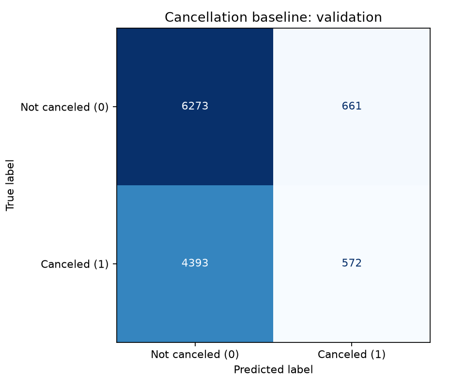
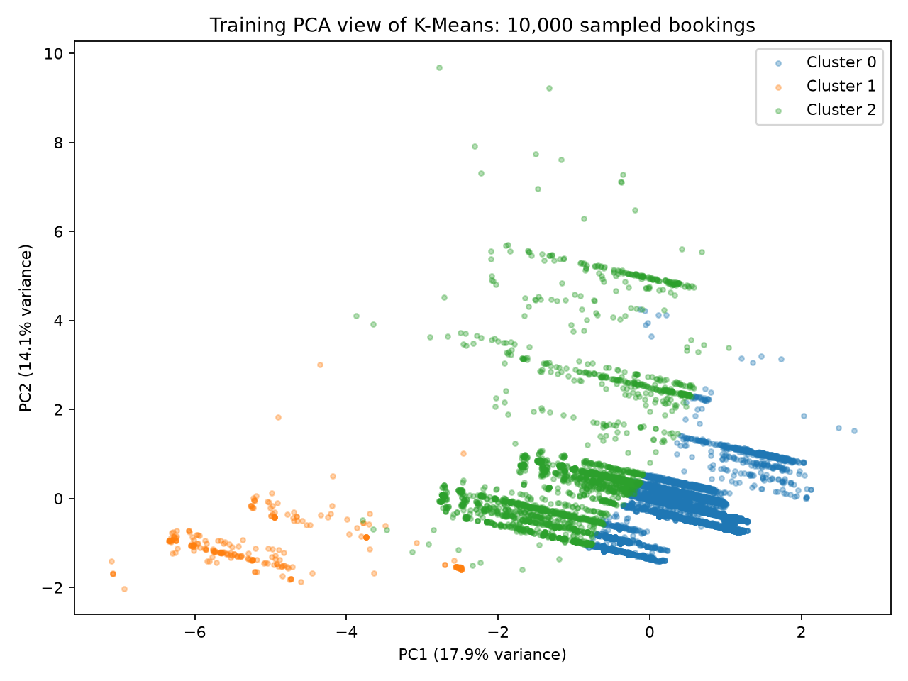

# City Hotel Booking Demand
### Milestone 1 — Data Preparation and Baseline Experiments

**Course:** CSE382 — Introduction to Machine Learning

**Date:** 5 November 2026

**Source file:** `H2.csv`

**Repository:** [City-Hotel-Booking-ML](https://github.com/City-Hotel-Booking/City-Hotel-Booking-ML)

> Data preparation and initial regression, classification and clustering
> experiments are implemented. The final supervised test set remains
> reserved for Milestone 2.

## 1. Project Overview

The project examines City Hotel bookings through three machine learning tasks:

| Task | Objective | M1 baseline |
| --- | --- | --- |
| Regression | Predict Average Daily Rate (`ADR`) | Linear Regression |
| Classification | Predict cancellation (`IsCanceled`) | Logistic Regression |
| Clustering | Explore bookings with similar characteristics | K-Means |

The working prediction point is initial booking entry into the hotel
Property Management System. The published data is a later snapshot, so
some recorded values may include subsequent amendments. Booking-entry
availability remains a limitation of the current experimental assumptions.

## 2. Data Understanding and Preparation

H2 contains **79,330 bookings and 31 source variables**, with arrival dates
from July 2015 through August 2017. H1 was not included.

Validation and EDA cover dimensions, types, missing values, duplicates,
category frequencies, unusual records and distributions. The saved outputs
include **15 EDA tables and seven figures**.

| Finding | Treatment |
| --- | --- |
| Four unknown `Children` values | Retain missingness; learn numeric imputation from training rows |
| 24 unknown `Country` values | Document missingness; keep Country outside active model inputs |
| `Agent` and `Company` NULL categories | Preserve their not-applicable meaning; both fields remain inactive |
| 25,902 excess identical rows in 5,846 groups | Retain records and keep normalized identical groups within one split |
| 331 zero-night and 1,208 zero-ADR records | Retain and document; these populations overlap |
| Maximum ADR of 5,400 | Retain and examine its effect on regression errors |
| Right-skewed lead time | Apply the configured `log1p` transformation in scaled preprocessing |

No source rows were manually removed or edited. Unusual values are
review findings rather than automatic evidence of invalid records.



*ADR includes a sparse extreme tail. The zoomed display does not remove
records from the experiments.*



*Unknown values are distinguished from not-applicable identifier categories.*

[EDA findings](../reports/eda_notes.md) · [Data review](../reports/data_review.md)

## 3. Experimental Setup

### Frozen data assignments

| Subset | Rows | Purpose |
| --- | ---: | --- |
| Training | 55,532 | Fit preprocessing and models |
| Validation | 11,899 | Evaluate supervised development results |
| Test | 11,899 | Reserved for final supervised evaluation |

The split uses seed **42**, cancellation-class stratification and grouping
of identical normalized source records. No identical normalized group
crosses subsets. Source row IDs and assignments remain unchanged.

- Split version: `m1-group-stratified-v1`
- Feature-policy version: `m1-draft-1`
- Active features: **16 regression, 16 classification and 11 clustering**

Feature choices reflect the assumed booking-entry point. Targets, final
reservation status/date and later booking-change information are excluded
from active inputs. Exact lists and reasoning are recorded in
[the feature policy](../src/features/policy.py).

### Shared preprocessing

Each task receives a fresh, unfitted transformer. Numeric processing
includes parsing, training-median imputation and scaling where required.
Scaled models use the configured lead-time transformation. Categorical
processing uses a missing marker and one-hot encoding with unseen-category
handling.

Supervised preprocessing and the estimator are fitted together in a
pipeline on training rows only. Clustering uses a separate dense distance
representation containing **45 transformed features**.

## 4. Baseline Experiments and Results

### 4.1 ADR Regression — Linear Regression

The untuned baseline retains all training and validation records with
finite ADR. No target clipping, duplicate removal or task-specific row
exclusion is applied.

| Metric | Training | Validation |
| --- | ---: | ---: |
| MAE | 17.4007 | 18.1992 |
| RMSE | 24.4205 | 54.9850 |
| R² | 0.5755 | 0.2689 |

**Pipeline fitting time:** 2.3636 seconds.

The relatively small increase in MAE suggests that typical absolute errors
are similar across training and validation. RMSE increases much more
strongly because it gives greater weight to large errors.

The validation ADR=5,400 record contributes **78.81%** of total validation
squared error, while the highest training ADR is only 451.50. This explains
much of the RMSE gap; the gap alone does not establish ordinary overfitting.

The model produces 58 negative validation predictions. This is a limitation
of unconstrained linear regression for a nonnegative rate and should be
considered when comparing later models.



*Residual evidence for the untuned linear baseline.*

Additional fixed-configuration experiments evaluated HistGradientBoosting
and Random Forest under the same development protocol:

| Additional model | Validation MAE | Validation RMSE |
| --- | ---: | ---: |
| HistGradientBoosting | 15.0025 | 53.7516 |
| Random Forest | 12.5223 | 52.8052 |

Both reduce MAE relative to the linear reference, while extreme ADR still
dominates RMSE. These are preliminary comparisons, not systematically
tuned or deployed models.

[Baseline report](../reports/regression_m1.md) ·
[Additional comparison](../reports/regression_enhancement_m1.md) ·
[Baseline metrics](../outputs/regression/metrics.json)

### 4.2 Cancellation Classification — Logistic Regression

The baseline uses `C=1.0`, `lbfgs`, `max_iter=2000`, seed 42 and no class
weighting. Cancellation is positive class **1**, with a fixed decision
threshold of **0.5**.

| Validation metric | Result |
| --- | ---: |
| Accuracy | 0.575258 |
| Precision | 0.463909 |
| Recall | 0.115206 |
| F1 | 0.184576 |
| ROC-AUC | 0.639444 |
| Average precision | 0.519298 |

**Pipeline fitting time:** 3.2759 seconds.

The model correctly identifies 572 canceled bookings but misses 4,393.
It also flags 661 noncanceled bookings as cancellations.

At the fixed threshold, accuracy is **57.53%**, below the **58.27%**
majority-class reference, and cancellation recall is only **11.52%**.
The baseline is therefore weak for identifying cancellations.

ROC-AUC indicates some ranking ability, but that does not translate into
strong cancellation detection at threshold 0.5. Future comparisons should
consider precision, recall, F1 and ranking metrics together.



*Validation confusion matrix, with true labels on rows and predictions
on columns.*

[Classification report](../reports/classification_m1.md) ·
[Metrics and settings](../outputs/classification/metrics.json)

### 4.3 Booking Clustering — K-Means

The baseline fits all **55,532 training bookings** using fixed `k=3`,
`n_init=10` and seed 42. It receives no target labels. The cluster count
is an initial reference rather than an optimized choice.

| Measure | Result |
| --- | ---: |
| Silhouette | 0.244930 |
| Davies–Bouldin index | 1.834343 |
| Inertia | 337,341.391467 |
| K-Means fitting time | 2.5091 seconds |
| Preprocessing time | 1.5949 seconds |

Silhouette uses a fixed sample of 3,000 training bookings. Davies–Bouldin
uses all training representations. Both are calculated before PCA.

| Cluster | Bookings | Median lead time | Observed characteristic |
| --- | ---: | ---: | --- |
| 0 | 39,945 | 131 days | Longer planning horizon |
| 1 | 1,328 | 5 days | Contains all repeated-guest training bookings |
| 2 | 14,259 | 11 days | Shorter planning horizon and higher mean child count |

The modest silhouette indicates overlapping groups rather than strong
separation. The repeated-guest cluster also shows sensitivity to scaling
a rare binary feature. These findings describe booking groups, not
validated customer segments or cancellation-risk categories.



*Training-fitted PCA visualization of 10,000 sampled bookings. Two components
retain 32.02% of variance, so the projection cannot establish separation
in the complete representation.*

[Clustering report](../reports/clustering_m1.md) ·
[Metrics](../outputs/clustering/metrics.json) ·
[Profiles](../outputs/clustering/cluster_profiles.csv)

## 5. Preliminary Leakage Audit

| Risk | Control and remaining limitation |
| --- | --- |
| Direct targets and final outcomes | Targets and final-status fields are excluded from active inputs |
| Mutable booking attributes | Booking-entry timing is documented, but original values cannot be established from the snapshot alone |
| Duplicate overlap | Normalized identical records remain in one subset; other repeated real bookings may remain unidentified |
| Learned preprocessing | Medians, scales and categories are learned from training data |
| Clustering sample provenance | No target is supplied to K-Means, but inherited training membership comes from cancellation-stratified assignment |
| Dimensionality reduction | Clustering PCA fits training data for visualization only |
| Model selection | Baselines use fixed settings; the additional regression comparison uses validation MAE |
| Final evaluation | All three baseline result records state `test_set_evaluated=false` |

Full-source EDA remains descriptive. Its percentiles are not used as
all-data fitted clipping thresholds. The grouped random split does not
measure future-period drift, and repeated selection on validation data
may overfit that subset.

Preprocessing, any learned feature transformations and future tuning must
remain inside the appropriate training folds. Scientific assumptions
remain documented as provisional in the decision tracker.

[Detailed leakage audit](../reports/leakage_audit_m1.md) ·
[Experiment decisions](../reports/decisions.md)

## 6. Team Contributions

| Member | GitHub account | Contribution |
| --- | --- | --- |
| Zeina | `zeihany0375` | Data loading, validation, EDA and data-quality evidence |
| Michael | `MichaelHany48` | Frozen split, feature policy, preprocessing and leakage review |
| Paula | `PaulaAdelDev` | Regression baseline, additional model comparison, tests and reports |
| Youssef | `youssefklopp-del` | Classification baseline, evaluation, tests and report |
| Aya | `ayaoraby63` | Clustering baseline, diagnostics, profiles, visualization and tests |
| Makarious | `makarioussafa` | Shared integration, result handling, documentation and submission verification |

Original implementations and contribution history are preserved.
Submission verification reran the existing models in a shared environment;
it did not replace the task owners' implementations.

## 7. Verification and Reproduction

The integrated test suite passed **122 tests and two subtests**.
Independent data verification passed its **31 unittest checks**, and
clustering preparation passed **15/15 checks**. These checks overlap in
scope and are not added together as separate test totals.

All three baselines ran successfully using **Python 3.13.6**.
`requirements.txt` pins runtime packages, while `requirements-dev.txt`
includes them and the pinned test runner.

After placing the unchanged `H2.csv` at `data/H2.csv`, run from the
repository root:

```powershell
python -m venv .venv
.\.venv\Scripts\python.exe -m pip install -r requirements-dev.txt

.\.venv\Scripts\python.exe main.py validate
.\.venv\Scripts\python.exe main.py analyze
.\.venv\Scripts\python.exe main.py prepare
.\.venv\Scripts\python.exe -m src.preprocessing.checks

.\.venv\Scripts\python.exe main.py baseline --task regression
.\.venv\Scripts\python.exe main.py baseline --task classification
.\.venv\Scripts\python.exe -m src.clustering.check_preprocessing
.\.venv\Scripts\python.exe main.py baseline --task clustering

.\.venv\Scripts\python.exe scripts/verify_outputs.py
.\.venv\Scripts\python.exe -m pytest -q
```

The additional regression comparison runs with:

```powershell
.\.venv\Scripts\python.exe -m src.regression.improve
```

Runtime and small floating-point differences may vary across environments.
Saved records identify the environment and settings of each experiment.

## 8. Milestone 2 Direction

Milestone 2 will extend the initial experiments into the complete workflow
required by the course. Work will cover broader model comparisons, tuning,
dimensionality-reduction experiments, final evaluation and a usable
application with saved inference pipelines.

Specific experimental choices will be documented as they are developed.
The current baselines will remain references for assessing subsequent
results, and the reserved supervised test set will be used only after
model-selection decisions are fixed.
