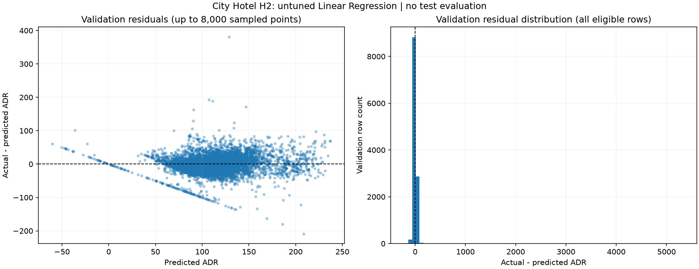
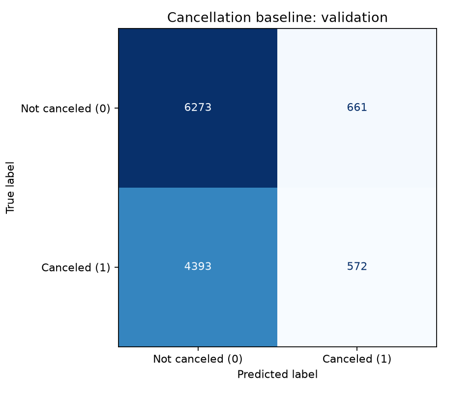
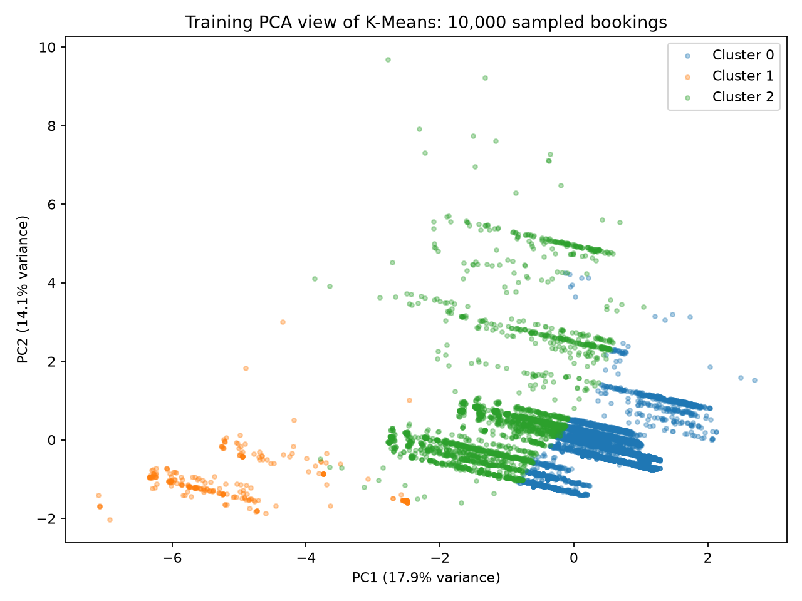

# City Hotel Booking Demand


> A CSE382 machine learning project exploring hotel rates, booking cancellations
> and booking segments using the City Hotel H2 dataset.

**79,330 bookings · 31 source variables · Three initial baselines**

## Project at a glance

| Task | Question | Implemented baseline |
| --- | --- | --- |
| Regression | What recorded Average Daily Rate is associated with a booking? | Linear Regression |
| Classification | Will a booking be canceled? | Logistic Regression |
| Clustering | Which bookings share similar characteristics? | K-Means |

Milestone 1 covers data understanding, reusable preparation and initial experiments.
The working prediction point is initial booking entry. H2 is a later snapshot,
so feature-timing and population assumptions remain provisional.

## Current results

| Experiment | Evaluation | Main results |
| --- | --- | --- |
| Linear Regression | Validation: 11,899 rows | MAE **18.1992** · RMSE **54.9850** · R² **0.2689** |
| Logistic Regression | Validation: 11,899 rows | Accuracy **57.53%** · F1 **0.1846** · ROC-AUC **0.6394** |
| K-Means, k=3 | Training: 55,532 rows | Sampled silhouette **0.2449** · Davies–Bouldin **1.8343** |

Regression error is strongly affected by an extreme validation ADR.
Classification has low cancellation recall at its fixed 0.5 threshold and
does not outperform the majority-class accuracy reference. Clustering shows
overlapping groups and sensitivity to feature scaling, rather than validated
business segments. These are development results; final supervised test
performance has not been evaluated.

Paula's additional fixed-configuration regression comparison is preserved
alongside the original baseline. It is not systematic hyperparameter tuning.

<details>
<summary><strong>View baseline figures</strong></summary>

### Regression residuals


### Cancellation classification


### Booking groups


The clustering plot is a training-fitted 2D projection retaining 32.02% of
variance. Clustering and internal metrics use the original prepared features.

</details>

## Completed work

- Source validation, missing-value and duplicate review, and unusual-record analysis.
- Fifteen EDA tables and seven descriptive figures.
- Frozen grouped and cancellation-stratified assignments with seed 42.
- Task-specific feature policy and a preliminary leakage audit.
- Fresh reusable preprocessing fitted on training data.
- Three baseline runners, saved results, task reports and tests.
- Successful baseline execution in the shared submission environment.

**Verification:** 122 tests and two subtests passed in the integrated suite.
Clustering preparation passed 15/15 checks. The independent data verifier
also passed its 31 unittest checks; these counts overlap with the full suite.

## Dataset and evaluation

Use **H2.csv only**. Obtain the [course-specified H2 mirror](https://raw.githubusercontent.com/afaq-ahmad/Hotel-booking-demand-Case-Study/master/H2.csv)
and place the unchanged file at `data/H2.csv`. Raw data is excluded from Git.

| Training | Validation | Reserved test |
| ---: | ---: | ---: |
| 55,532 | 11,899 | 11,899 |

Identical normalized records stay within one subset. This random split does
not measure future-period drift. Active input counts are 16 for regression,
16 for classification and 11 for clustering.

Source identity and ordering are verified against the frozen split.
See [data setup](data/README.md), [feature policy](src/features/policy.py),
[experiment decisions](reports/decisions.md) and
[leakage audit](reports/leakage_audit_m1.md).

## Setup and run

Run from the repository root using **Python 3.13.6**. Runtime packages are
pinned in `requirements.txt`; development requirements add the test runner.

```powershell
python -m venv .venv
.\.venv\Scripts\python.exe -m pip install -r requirements-dev.txt
.\.venv\Scripts\python.exe main.py --help
```

### Data preparation

```powershell
.\.venv\Scripts\python.exe main.py validate
.\.venv\Scripts\python.exe main.py analyze
.\.venv\Scripts\python.exe main.py prepare
.\.venv\Scripts\python.exe -m src.preprocessing.checks
```

### Baseline experiments

```powershell
.\.venv\Scripts\python.exe main.py baseline --task regression
.\.venv\Scripts\python.exe main.py baseline --task classification
.\.venv\Scripts\python.exe -m src.clustering.check_preprocessing
.\.venv\Scripts\python.exe main.py baseline --task clustering
```

Additional regression comparison:

```powershell
.\.venv\Scripts\python.exe -m src.regression.improve
```

### Verification

```powershell
.\.venv\Scripts\python.exe scripts/verify_outputs.py
.\.venv\Scripts\python.exe -m pytest -q
```

The verifier checks source evidence and runs unittest-compatible tests;
pytest runs the complete suite. Analysis and experiment commands regenerate
their outputs, so inspect differences before committing. Runtime and small
floating-point differences can vary across environments.

For alternative settings, place `--config` before the command:

```powershell
.\.venv\Scripts\python.exe main.py --config experiment.yaml baseline --task regression
```

Paths in configuration files are relative to the project root.

## Repository layout

| Location | Contents |
| --- | --- |
| `src/` | Data, features, preprocessing, experiments and result handling |
| `outputs/` | Validation evidence, frozen assignments, tables, metrics and figures |
| `reports/` | Task reports, data findings, decisions and leakage audit |
| `docs/` | Code and task-specific guides |
| `tests/` · `scripts/` | Automated checks and output verification |
| `app/` · `src/inference/` · `src/tuning/` | Planned M2 extensions |
| `artifacts/` | Local fitted objects, excluded from Git |

## Team

| Member | Account | Contribution |
| --- | --- | --- |
| Zeina | [zeihany0375](https://github.com/zeihany0375) | Data loading, validation and EDA |
| Michael | [MichaelHany48](https://github.com/MichaelHany48) | Shared preparation, feature policy and leakage review |
| Paula | [PaulaAdelDev](https://github.com/PaulaAdelDev) | Regression experiments |
| Youssef | [youssefklopp-del](https://github.com/youssefklopp-del) | Classification experiment |
| Aya | [ayaoraby63](https://github.com/ayaoraby63) | Clustering experiment |
| Makarious | [makarioussafa](https://github.com/makarioussafa) | Integration, result handling and submission verification |

See [team contributions and workflow](CONTRIBUTING.md) for responsibilities
and review rules.

## Next milestone

M2 will extend model comparisons, tuning, dimensionality reduction and final
evaluation, then expose saved inference pipelines through a usable application.
Specific experiments will be documented as they are developed.

| Milestone | Deadline |
| --- | --- |
| M1: preparation and initial baselines | 5 November 2026 |
| M2: complete end-to-end project | 11 December 2026 |

## Repository

[City-Hotel-Booking-ML](https://github.com/City-Hotel-Booking/City-Hotel-Booking-ML)